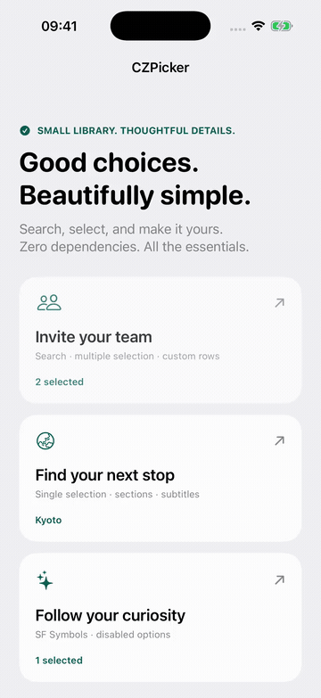
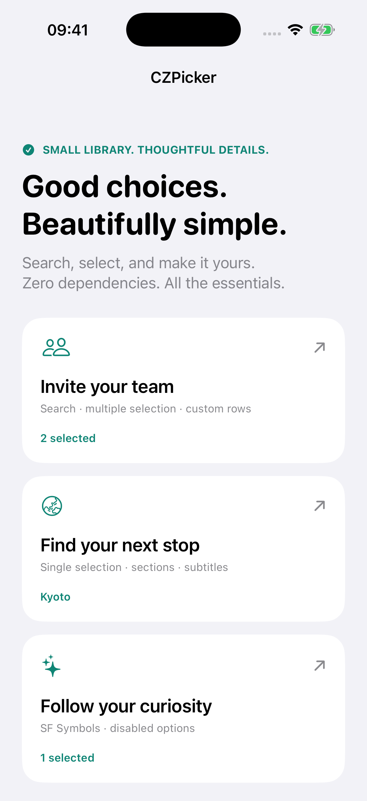
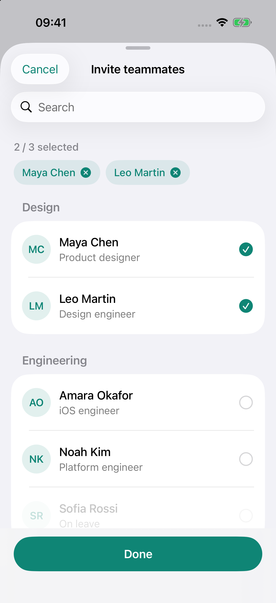
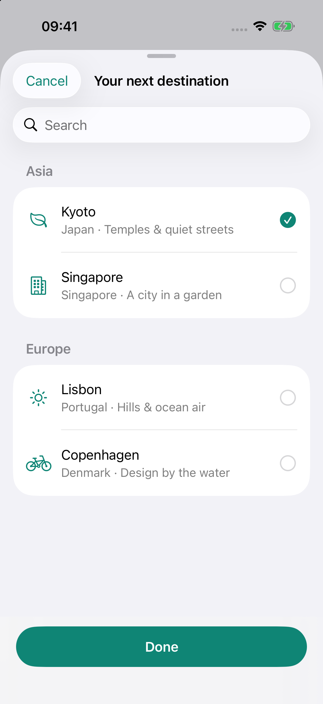

<div align="center">

# CZPicker

### Good choices. Beautifully simple.

Searchable selection sheets for **SwiftUI and UIKit**.<br>
Single or multiple selections. Thoughtful defaults. **Zero external dependencies.**

[Screenshots](#at-a-glance) · [Quick start](#quick-start) · [Try the showcase](#try-the-showcase) · [UIKit](#uikit) · [Migration](docs/MIGRATION.md)

</div>

<p align="center">
  
</p>
<p align="center">
  <sub>Recorded from the running showcase on an iPhone simulator. No mockups.</sub><br>
  <a href="docs/media/czpicker-demo.mp4">Watch the MP4</a> · <a href="#at-a-glance">Browse screenshots</a>
</p>

## At a glance

Real screenshots from the running showcase. Click any image for a closer look.

<table>
  <tr>
    <th>Explore the showcase</th>
    <th>Choose several</th>
    <th>Choose one</th>
  </tr>
  <tr>
    <td align="center"><a href="docs/images/showcase.png"></a></td>
    <td align="center"><a href="docs/images/teammates.png"></a></td>
    <td align="center"><a href="docs/images/destination.png"></a></td>
  </tr>
  <tr>
    <td align="center">Three ready-to-run examples to start from.</td>
    <td align="center">Search, selected chips, and custom rows.</td>
    <td align="center">Grouped options with an explicit Done action.</td>
  </tr>
</table>

**Pick a team. Choose a destination. Find your interests.** CZPicker handles the selection details so you can focus on your app.

- **Search without losing your place.** Selected items stay visible as removable chips while you filter.
- **Done means done.** Changes remain a draft until confirmation. Cancel or swipe down to leave your original selection untouched.
- **Your data, your identity.** Stable IDs preserve selection across sorting and filtering.
- **Just enough control.** Single/multiple selection, optional limits, sections, disabled options, and custom SwiftUI rows.
- **Fits your app.** Semantic colors, scalable text, native sheets, and a UIKit presenter using the same modern UI.
- **Nothing else to install.** No transitive packages, networking, analytics, or bundled demo assets.

> **1.0 preview:** This branch contains the relaunch implementation. Version `1.0.0-beta.1` is not yet published. Use the branch instructions below to try it; the existing `0.4.3` release does not include these APIs. See the [release checklist](docs/RELAUNCH_PLAN.md#release-checklist) for remaining validation.

## Already using CZPicker?

**Keep your existing integration.** The `CZPickerView` header and implementation are unchanged from 0.4.3: the same methods, delegate callbacks, ownership, selection behavior, and appearance. The default CocoaPod still uses that implementation. The new `CZPickerUI` experience is opt-in.

The minimum OS is now **iOS 15** for the existing API and **iOS 16** for the modern API. See [compatibility details](docs/MIGRATION.md) and the [checks performed](docs/VALIDATION.md).

## Installation

### Swift Package Manager — recommended

In Xcode, choose **File → Add Package Dependencies**, enter:

```text
https://github.com/chenzeyu/CZPicker.git
```

For this preview, select **Branch → `feature/modern-relaunch`**. Add **CZPickerUI** for the modern API, or **CZPicker** for the Objective-C compatibility API.

For a package manifest:

```swift
.package(url: "https://github.com/chenzeyu/CZPicker.git", branch: "feature/modern-relaunch")
```

Then add `.product(name: "CZPickerUI", package: "CZPicker")` to your target's dependencies.

| Product | Minimum iOS | Import | Purpose |
| --- | --- | --- | --- |
| CZPickerUI | 16 | `import CZPickerUI` | Modern SwiftUI sheet and UIKit presenter |
| CZPicker | 15 | `import CZPicker` | Existing Objective-C delegate/data-source API |

The package uses Swift tools 5.9 (Xcode 15+). Both products have **zero external package dependencies**.

### CocoaPods

The same source files are available through subspecs:

```ruby
# Modern SwiftUI + UIKit interface (iOS 16+)
pod 'CZPicker/SwiftUI', :git => 'https://github.com/chenzeyu/CZPicker.git',
    :branch => 'feature/modern-relaunch'

# Or the Objective-C compatibility interface (iOS 15+)
pod 'CZPicker/Core', :git => 'https://github.com/chenzeyu/CZPicker.git',
    :branch => 'feature/modern-relaunch'
```

With CocoaPods, use **`import CZPicker`** in the Swift examples below. The default `CZPicker` pod selects `Core`; select both subspecs if you need both APIs. No other pods are required.

## Quick start

A complete SwiftUI example:

```swift
import SwiftUI
import CZPickerUI

struct InviteView: View {
    @State private var showingPicker = false
    @State private var selected: Set<String> = []

    private let people = [
        CZPickerItem(id: "maya", title: "Maya Chen", subtitle: "Designer"),
        CZPickerItem(id: "leo", title: "Leo Martin", subtitle: "Engineer"),
        CZPickerItem(id: "amara", title: "Amara Okafor", subtitle: "Engineer")
    ]

    var body: some View {
        Button("Invite teammates (\(selected.count))") {
            showingPicker = true
        }
        .sheet(isPresented: $showingPicker) {
            CZPickerSheet("Invite teammates", items: people,
                          selection: $selected,
                          mode: .multiple(maximum: 3))
                .tint(.teal)
        }
    }
}
```

Use `.single` for one choice, or `.multiple()` for no selection limit. Single selection still uses Done and can be cleared. The binding always contains a `Set<ID>`.

## Make it yours

Add an SF Symbol, subtitle, section, or disabled option:

```swift
CZPickerItem(id: "kyoto", title: "Kyoto", subtitle: "Japan",
             symbol: "leaf", section: "Asia")
CZPickerItem(id: "soon", title: "Coming soon", isEnabled: false)
```

Supply your own row with normal SwiftUI views:

```swift
CZPickerSheet("Invite teammates", items: people, selection: $selected) { person in
    HStack {
        Image(systemName: "person.crop.circle.fill")
            .font(.title).foregroundStyle(.teal)
        VStack(alignment: .leading) {
            Text(person.title).font(.headline)
            Text(person.subtitle ?? "").font(.subheadline).foregroundStyle(.secondary)
        }
    }
}
```

Set `searchable: false` for short lists. Customize action text with `doneTitle:`, `cancelTitle:`, and `searchPrompt:`. Search matches the title, subtitle, and section using locale-aware matching. Your custom row controls appearance; the item fields remain the searchable content.

## UIKit

Present the same modern experience from a view controller:

```swift
import CZPickerUI

let picker = CZPickerViewController(
    title: "Choose a destination",
    items: [CZPickerItem(id: "kyoto", title: "Kyoto", subtitle: "Japan")],
    selection: Set<String>(),
    mode: .single
) { selectedIDs in
    print(selectedIDs)
}
present(picker, animated: true)
```

For custom UIKit-hosted rows, wrap `CZPickerSheet` in your own `UIHostingController`. For existing Objective-C applications, the original `CZPickerView` API remains available through the `CZPicker` product. See [migration and legacy usage](docs/MIGRATION.md).

## Selection rules

- Give every item a unique, stable ID. Duplicate IDs display only the first occurrence.
- Filtering never removes selections. Removing an item from the supplied data does remove it from the draft.
- Initial selections are normalized to existing IDs and the limit, in source order. Negative limits behave as zero.
- Disabled options cannot be toggled, including through their chips. A preselected disabled option remains selected and counts toward the limit.
- `onConfirm` runs only on Done. `onCancel` runs only on the Cancel button; use the host sheet's `onDismiss` for all dismissal paths.
- Selection is captured when the sheet is created. Reopen it to apply a different selection mode or externally replaced selection.
- The library owns no network requests. Load data in your app and pass it in.

## Try the showcase

Open **[Examples/Showcase/Showcase.xcodeproj](Examples/Showcase/Showcase.xcodeproj)**, select the **Showcase** scheme, and run on an iPhone or iPad simulator. It uses the local package—no CocoaPods installation or project generator needed.

Explore teammate selection with custom avatar rows, destinations with single selection, interests with sections and disabled options, and a UIKit presentation example.

## Development

```sh
# Choose an installed simulator from: xcrun simctl list devices available
xcodebuild -scheme CZPicker-Package \
  -destination 'platform=iOS Simulator,name=iPhone 17 Pro' test

xcodebuild -project Examples/Showcase/Showcase.xcodeproj -scheme Showcase \
  -destination 'platform=iOS Simulator,name=iPhone 17 Pro' test

pod lib lint CZPicker.podspec --subspec=Core
pod lib lint CZPicker.podspec --subspec=SwiftUI
```

Regression tests cover modern selection limits, cancellation isolation, stable IDs, and data changes, plus the existing API’s ownership, defaults, selection semantics, and callback ordering. `scripts/check-legacy-api.sh` verifies the legacy sources against 0.4.3. Showcase UI tests exercise search, confirmation, cancellation, and UIKit presentation. See [validation notes](docs/VALIDATION.md) for the exact checks performed on this branch. A [GitHub Actions template](docs/ci/github-actions.yml) is included; copy it to `.github/workflows/ci.yml` to enable hosted CI.

## A small library, coming back to life

CZPicker began in 2015 as a customizable popup picker. This relaunch keeps the original API available and adds a modern, dependency-free experience for SwiftUI and UIKit.

Found something awkward? [Open an issue](https://github.com/chenzeyu/CZPicker/issues) with a small reproduction. Built something with CZPicker? We'd love to see it. If it saves you time, a star helps other developers discover it.

Contributions are welcome—see [CONTRIBUTING.md](CONTRIBUTING.md). Thanks to everyone who used, reported issues, and contributed to the original library, which was created at [Fooyo](https://fooyo.sg).

**MIT licensed.** See [LICENSE](LICENSE).
